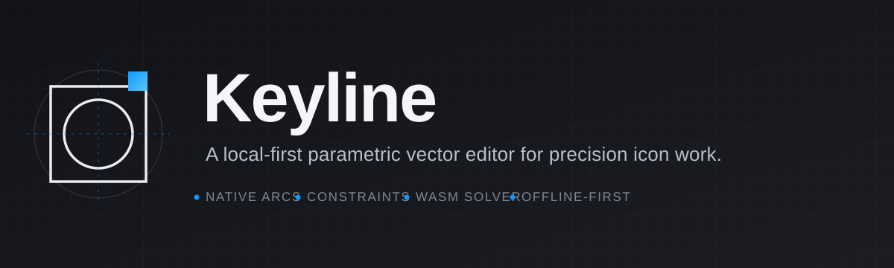

<p align="center"></p>

<h1 align="center">Keyline</h1>

<p align="center"><b>A local-first parametric vector editor for precision icon work.</b><br>
Draw with real arcs, keep geometry honest with constraints, check a whole icon set at once,
and export production-ready SVG, PNG, React and CSS — from your browser, with no account.</p>

<p align="center">
  <a href=".github/workflows/ci.yml"></a>
  
  
  
  
</p>

---

## Start here

Keyline is a **web app you run locally**, not a hosted service. Pick the path that matches you:

| I want to… | Go to |
|---|---|
| **Try it** (2 minutes) | [Quick start](#quick-start-2-minutes) |
| **Learn the tools** before drawing | [docs/USER-GUIDE.md](docs/USER-GUIDE.md) |
| **Understand the code** | [docs/ARCHITECTURE.md](docs/ARCHITECTURE.md) — module map and data flow |
| **Run tests / contribute** | [CONTRIBUTING.md](CONTRIBUTING.md) · [docs/TESTING.md](docs/TESTING.md) |
| **Change the look or add UI** | [docs/DESIGN-SYSTEM.md](docs/DESIGN-SYSTEM.md) — tokens, primitives, the gate |
| **Deploy or change collaboration** | [docs/COLLABORATION.md](docs/COLLABORATION.md) |
| **Fix my environment** | [docs/DEVELOPMENT.md](docs/DEVELOPMENT.md#troubleshooting) · [docs/FAQ.md](docs/FAQ.md) |
| **See what's missing** (honest list) | [Known limits](#known-limits) |
| **Read the security/audit record** | [SECURITY.md](SECURITY.md) · [docs/AUDIT.md](docs/AUDIT.md) |

> **Status: v0.1.0, source release.** Covers the icon workflow described below, verified by 318
> automated tests. It is not a hosted product and has no user accounts.

---

## What it is

Most vector tools store what you drew. Keyline also stores **how it is built**: nodes, typed
segments, native circular arcs, constraints, derived regions, and non-destructive parametric
groups. That model is what makes precision work repeatable — an arc stays an arc, a shared
stroke stays shared, and a fill stays attached to the boundary it belongs to even after you
reshape it.

It is built for people who draw **icon sets and small marks** and care that the output is
correct: consistent stroke widths, pixel-aligned bounds, clean SVG without editor metadata,
and a React component that compiles.

**Who it is for:** icon and product designers who want geometry that holds, design engineers
who want exportable code, and anyone who wants a capable vector editor that never uploads
their files.

---

## What you get

| | |
|---|---|
| **Drawing** | Pen, pencil, brush, rectangle, rounded rectangle, ellipse, polygon, star, line, **construction line**, native **arc**, shape builder, cut, bend, fillet, offset, variable width, region paint, lasso, eraser with healing. |
| **Geometry** | Eleven constraint types (`parallel`, `perpendicular`, `tangent`, `symmetric`, `equal_length`, `fixed_distance`, `fixed_angle`, `fixed_radius`, `horizontal`, `vertical`, `coincident`) with hard/medium/soft priorities, conflict diagnostics, and a deterministic solver. |
| **Precision** | Icon frames at 24/32/48 or custom size, artboard presets, pixel grid, numeric transforms with expressions, corner radii, aspect lock, one-shot Flow arrangements. |
| **Icon set view** | See every icon at once, search by name, and run consistency checks for stroke width, line ends, safe area, half-pixel alignment and minimum readable stroke. |
| **Families** | Link variants to a source with stable topology maps, propagate changes with a preview, keep intentional overrides, and run family QA with one-click undoable fixes. |
| **Import & tidy** | Drop an SVG anywhere. Optional tidy rules (straighten near-straight lines, merge collinear points, snap to grid) show their effect before import. |
| **Export** | SVG (artboard or artwork bounds, optional background), PNG at 1×/2×/3×/custom, batch ZIP with naming patterns and presets, React + TypeScript component, CSS variables, and a family change manifest. |
| **Motion** | Turn an exported SVG into a self-contained animated SVG using CSS keyframes — draw-on, pulse, swing or pop, with duration, delay, stagger, easing and loop controls. |
| **Collaboration** | Share a room link, edit together over Yjs, work offline and resync, and see remote cursors and selections. Room joins keep a **separate local file identity**. |
| **Your files** | A local dashboard with search, filters, rename, duplicate, delete (undoable) and thumbnails. Import SVG or restore a `.keyline.json` backup. Everything is stored in IndexedDB on this device. |
| **Two renderers** | Canvas 2D for compatibility, batched WebGL2 for large drawings, switched in **Settings → Performance**, with automatic fallback. |
| **Accessible by default** | Keyboard tools, labelled controls, modal focus containment, reduced-motion support, and automated WCAG A/AA checks in the browser suites. |
| **One design system** | 253 tokens in a single source, mirrored for the canvas renderers, one shared primitive layer, WCAG-checked colour pairs, and a build gate that fails on drift in colour, type, radius or layering. |

---

## Quick start (2 minutes)

**You need:** [Node.js](https://nodejs.org) **20.19+ or 22.12+** (22 LTS recommended) and npm.

```bash
git clone https://github.com/Ankushui18/keyline.git
cd keyline
npm ci
npm run dev
```

Open **http://localhost:5173**. The app and its collaboration relay start together; closing the
process stops both.

Production build:

```bash
npm run build
npm run preview
```

**No checkout?** Any static server over `dist/` works, but keep the `/collaboration` proxy if you
want sharing — the relay is a separate WebSocket service.

---

## A first icon, end to end

1. **New icon set** on the dashboard creates a 24 px frame.
2. Pick **Ellipse** (`U`) and drag; hold `Shift` to constrain it to a circle. Switch to **Pen** (`P`)
   for open paths.
3. Press **Enter** to edit points. Use **Fillet** (`F`) on a corner — it creates a real tangent arc,
   not a Bézier approximation.
4. Set the stroke in **Design**: width, cap, join, alignment. Lock what matters with **Constraints** (`K`).
5. Open **Check icons** (`Ctrl/⌘ ⇧ C`) to compare the whole set.
6. **Export** → SVG, PNG or React, or **Export set** to choose artboards and download a ZIP.

Full walkthrough: [docs/USER-GUIDE.md](docs/USER-GUIDE.md).

---

## Documentation

| Document | What it covers |
|---|---|
| [docs/USER-GUIDE.md](docs/USER-GUIDE.md) | Every tool, shortcut, panel, dialog and workflow. |
| [docs/ARCHITECTURE.md](docs/ARCHITECTURE.md) | Layers, module map, data flow, transaction and solver pipeline, where to change what. |
| [docs/DESIGN-SYSTEM.md](docs/DESIGN-SYSTEM.md) | Tokens, semantic roles, state tints, the primitive layer, canvas mirrors, and the rule that keeps them from drifting. |
| [docs/DEVELOPMENT.md](docs/DEVELOPMENT.md) | Setup, scripts, environment variables, Rust/Wasm rebuild, troubleshooting. |
| [docs/TESTING.md](docs/TESTING.md) | What each suite proves, how to run it, how to add coverage. |
| [docs/COLLABORATION.md](docs/COLLABORATION.md) | Yjs model, relay limits, deployment boundary, revocation reality. |
| [docs/FAQ.md](docs/FAQ.md) | Storage, privacy, offline use, compatibility, common confusions. |
| [docs/AUDIT.md](docs/AUDIT.md) | The full audit-and-remediation record with evidence. |
| [CONTRIBUTING.md](CONTRIBUTING.md) · [SECURITY.md](SECURITY.md) · [CHANGELOG.md](CHANGELOG.md) | How to contribute, how to report a vulnerability, what changed. |
| [solver/README.md](solver/README.md) · [src/constraints/README.md](src/constraints/README.md) | Wasm boundary and the two-solver contract. |

---

## Repository map

```
keyline/
├── README.md                    ← you are here
├── docs/                        architecture, user guide, testing, FAQ, audit
│   └── assets/                  banner, data-flow and design-system diagrams (hand-authored SVG)
├── src/
│   ├── App.tsx                  editor orchestration: tools, shortcuts, dialogs, autosave
│   ├── main.tsx                 entry point; imports the layered stylesheets in order
│   ├── core/                    document, geometry, operations, regions, persistence,
│   │                            types, appearance rules, families, preferences
│   ├── constraints/             TS solver, Wasm worker client, serialization, catalog
│   ├── canvas/                  Canvas 2D renderer, WebGL2 renderer, viewport, culling
│   ├── tools/                   select, pen, pencil, brush, primitives, bend, cut, fillet,
│   │                            offset, width, lasso, eraser, snapping, shape builder
│   ├── export/                  SVG, PNG, ZIP delivery, React/CSS code, motion, manifest
│   ├── import/                  SVG parsing, import preview, tidy rules
│   ├── collaboration/           Yjs session, snapshot replay, hashing
│   ├── ui/                      dashboard, toolbar, layers, inspector, dialogs, command bar
│   ├── design-system/           tokens.ts (canvas mirror), document defaults, BrandMark
│   └── styles/
│       ├── system/              tokens.css (the only place a colour is named), base.css,
│       │                        components/ui.css (shared primitives)
│       └── *.css                feature stylesheets; refine component styles, never tokens
├── solver/                      Rust crate (`src/lib.rs`) + committed Wasm package (`pkg/`)
├── server/                      development collaboration relay
├── scripts/                     dev/preview runner, solver + WebSocket tests, browser suites,
│                                documentation checker, design-system gate + colour codemod
├── .github/workflows/ci.yml     design gate, build, unit/integration tests, solver smoke test,
│                                Rust tests, documentation checks
├── CONTRIBUTING.md · SECURITY.md · CHANGELOG.md · LICENSE (MIT)
└── .gitignore                   keeps caches, logs and audit output out of Git
```

**Rule of thumb:** UI never mutates geometry directly; changes go through
`OperationManager`. See [docs/ARCHITECTURE.md](docs/ARCHITECTURE.md#where-to-change-what).

---

## Quality

```bash
npm ci
npm run check      # design gate + build + tests + Wasm smoke + relay + doc links
npm test           # 318 tests across 57 test files
npm run test:solver
npm run test:collaboration
npm run check:docs # every relative doc link resolves
npm run check:design # tokens, CSS↔TS parity, colour/type/radius/z-index, contrast
npm run audit:design # design-consistency report: how many values each dimension uses
npm run test:conformance # resolve the cascade; check contrast + button geometry
npm run proof:design # render the design system to design-proof/index.html
```

Every push runs [CI](.github/workflows/ci.yml) on Node 22 and Rust stable:

- **Strict TypeScript** (`noUnusedLocals`, `noUnusedParameters`) and a production Vite build.
- **318 tests / 57 files** covering geometry, native arcs, regions, constraints, transactions,
  persistence, export fidelity and escaping, collaboration replay, and performance budgets.
- **A real Wasm smoke test** that loads the committed artifact and checks native-arc solving —
  not a mock of the boundary.
- **Nine real WebSocket checks** against the relay: origin and room-path validation, cross-room
  isolation, offline convergence, payload caps and idle-room expiry.
- **Rust unit tests** for direct arc radius/endpoint solving and rejection of proxy geometry.
- **A design-system gate** so one palette stays one palette: token integrity, CSS↔TS parity,
  a literal-colour ratchet, no dangling `var(--x)`, type/radius/spacing/z-index on scale, and
  eleven WCAG contrast pairs.
- **A conformance run** that resolves the entire cascade and checks 361 ink/background pairs and
  the geometry of 27 button classes — it caught four invisible-on-active icons and nine sub-AA
  text pairs the source-level gate could not see.
- **Documentation checks** so relative links cannot rot and the published test count cannot drift.

Browser suites are available locally but are **not** in CI because they require a preinstalled
Playwright CLI and Chromium:

```bash
npm run dev                          # in another terminal
playwright-cli -s=arena open http://127.0.0.1:5173 --browser=chromium
npm run test:browser                 # end-to-end + accessibility
npm run test:design                  # sidebar layout, resizing, accessibility
npm run test:review                  # palette, icon rendering, onboarding
playwright-cli -s=arena close
```

Results and screenshots are written to `audit/` (ignored by Git). Counts and scope:
[docs/TESTING.md](docs/TESTING.md). The audit history and limitations:
[docs/AUDIT.md](docs/AUDIT.md).

---

## Known limits

Honest list — these are deliberate boundaries, not hidden defects.

- **This is not a hosted product or a multi-tenant backend.** Files live in your browser's
  IndexedDB on this device. The bundled collaboration relay is for development and previews;
  it has no accounts, authentication or durable storage. See
  [docs/COLLABORATION.md](docs/COLLABORATION.md#deployment-boundary).
- **A share link is an edit capability.** Turning sharing off disconnects *this device*; it does
  not revoke a link or delete copies peers already hold.
- **Desktop browser first.** The UI targets pointer and keyboard on Chromium-class desktop
  browsers; touch-first use and mobile layout are not tested.
- **"Ask for an edit" is not an AI model.** It reads a small set of deterministic phrases
  (`thinner`, `round ends`, `no fill`, `line color black`, …) entirely on-device and refuses
  anything it cannot parse. No model is connected and nothing is sent anywhere.
- **Browser persistence is best effort.** Blocked or full IndexedDB, or an abrupt process kill,
  can prevent the last save. The app reports save failures and offers a downloadable
  `.keyline.json` copy, which can be restored by importing it from the dashboard.
- **Rust is only needed to rebuild the solver.** The compiled Wasm package is committed, so
  `npm ci && npm run dev` works without a Rust toolchain; source-to-artifact reproducibility is
  not claimed.
- **Accessibility coverage is scoped.** Zero automated violations in the tested Chromium states
  is regression evidence, not a WCAG conformance certification or a screen-reader audit.
- **Maintenance follow-ups remain.** `App.tsx` and `PropertiesPanel.tsx` are large, and the CSS
  is layered by delivery phase. A modularization and bundle-budget pass is future work; it was
  intentionally not mixed into the documented fixes.
- **Out of scope:** 3D/CAD, mobile apps, real-time multiplayer for untrusted tenants, and new
  editing tools beyond the documented set.

---

## Privacy

- **Your drawings never leave the device** unless you join a collaboration room. Export writes a
  file where you choose to save it.
- **No analytics, no accounts, no tracking, no third-party requests at runtime.** Fonts are
  bundled locally (`src/assets/`).
- **Collaboration is the only network feature.** It talks to the same origin under
  `/collaboration`, proxied to the local relay.
- Full detail, including what is stored in the browser: [SECURITY.md](SECURITY.md) and
  [docs/FAQ.md](docs/FAQ.md#where-are-my-files-stored).

---

## License

[MIT](LICENSE) — free for personal and commercial use. Issues and ideas:
[CONTRIBUTING.md](CONTRIBUTING.md).
