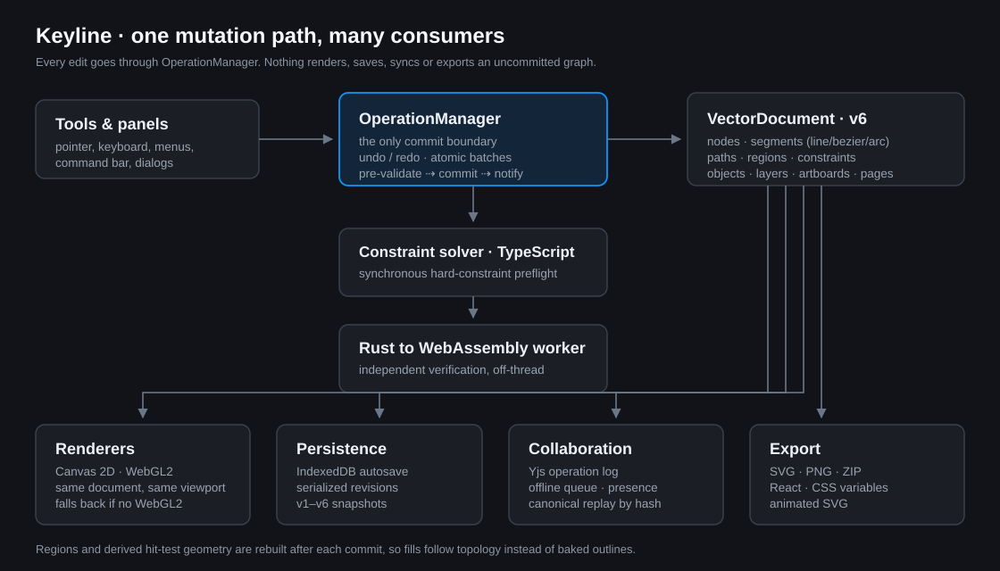

# Architecture

How Keyline is organised, how an edit travels from a pointer event to pixels, disk and the
network, and where to change things without breaking the model.

- [The one rule](#the-one-rule)
- [Layers](#layers)
- [Module map](#module-map)
- [Data flow](#data-flow)
- [The transaction pipeline](#the-transaction-pipeline)
- [The document model](#the-document-model)
- [Regions, fills and widths](#regions-fills-and-widths)
- [The two solvers](#the-two-solvers)
- [Persistence](#persistence)
- [Collaboration](#collaboration)
- [Rendering](#rendering)
- [Export pipelines](#export-pipelines)
- [Families and appearance rules](#families-and-appearance-rules)
- [UI composition and styles](#ui-composition-and-styles)
- [Invariants](#invariants)
- [Where to change what](#where-to-change-what)

---

## The one rule

**UI code never mutates geometry.** Every change — a dragged node, a new artboard, an import,
a solver adjustment, a collaboration replay — is an `OperationDescriptor` handed to
`OperationManager`. The manager validates, applies, records an inverse, rebuilds derived state
and emits a change event. If validation or solving fails, it rolls back and throws.

This is what makes undo/redo, autosave, collaboration and export trustworthy: they all observe
the same committed graph.

```text
pointer/keyboard/menu → prepare*()  → OperationInput → OperationManager.execute()
                                                             │
                        validate → apply → solve → rollback or commit
                                                             │
                                     refreshRegions() → emit(committed)
                                                             │
                    ┌───────────────┬────────────────┬───────┴────────┐
                 renderer        autosave        collaboration      export
```



---

## Layers

| Layer | Location | Responsibility | May import from |
|---|---|---|---|
| Entry | `src/main.tsx` | Mount React, import stylesheets in order, preload the UI font. | `App`, `styles` |
| Orchestration | `src/App.tsx` | Owns the manager, selection, viewport mode, dialogs, tool switching, keyboard map, autosave lifecycle, import/export/collaboration wiring. | everything below |
| Domain | `src/core`, `src/constraints`, `src/collaboration` | Document, geometry, operations, regions, solver, serialization, persistence, families, Yjs session. | `types` and pure utilities |
| Interaction | `src/tools` | Pure `prepare*` functions and tool state machines that turn input into operations. | `core` |
| Presentation | `src/canvas`, `src/ui`, `src/styles` | Renderers, panels, dialogs, dashboard, command bar, CSS. | domain read-only |
| Services | `server/`, `scripts/` | Development relay, test harnesses, dev runner. | — |
| Native | `solver/` | Rust `f64` solver compiled to Wasm. | — |

Domain code has no React dependency. Tools return operations but never apply them. This keeps
the geometry testable in Node and reusable by the worker.

---

## Module map

### `src/core`

| File | Role |
|---|---|
| `types.ts` | The complete document schema: nodes, segments (line/Bézier/native arc), paths, regions, constraints, parametric groups, appearance, layers, artboards, pages, export metadata, families. |
| `document.ts` | `VectorDocument`, an in-memory typed graph with read accessors, snapshot/restore and geometry validation. Mutation methods are internal and only called by the manager. |
| `operations.ts` | `OperationManager`: the commit boundary, inverse operations, transactions (`beginTransaction`/`commitTransaction`/`rollbackTransaction`), undo/redo, validators, diagnostics, region refresh, change events. |
| `geometry.ts` | Line, cubic Bézier and native-arc kernel: evaluation, tangents, flattening, intersections, splitting. |
| `regions.ts` | Planar region detection from segment topology and stable region IDs. |
| `region-geometry.ts` | Loop ordering, winding/even-odd hit testing, triangulation, area, interior points. |
| `object-geometry.ts` | Object transforms, bounds, canvas-space projections. |
| `object-operations.ts`, `artboard-operations.ts` | Prepared plans for delete/duplicate/flip, icon frames, artboard duplication and deletion. |
| `parametric.ts` | Mirror and radial-repeat group validation and transform evaluation. |
| `appearance-rules.ts`, `drawing-style.ts`, `corner-radius.ts` | Shared style rules, pen/pencil defaults, radius clamping. |
| `family-qa.ts`, `family-collection.ts`, `geometry-components.ts` | Family source/variant topology, propagation previews, QA and fixes. |
| `clipboard.ts`, `browser-clipboard.ts` | In-app vector clipboard payloads and a permission-safe browser clipboard wrapper. |
| `store.ts` | IndexedDB persistence, autosave controller (`DocumentPersistence`), thumbnails, dashboard summaries. |
| `preferences.ts` | Safe `localStorage` access with an in-memory fallback. |
| `consistency.ts` | Icon-set consistency checks (width, ends, safe area, half-pixel, small stroke). |
| `quick-edit.ts` | Deterministic phrase reader for appearance edits. No model, no network. |
| `numeric-expression.ts` | Numeric field expressions (`24/2`, `12+4`). |
| `real-content.ts`, `ids.ts`, `consistency.ts`, `inspector-layout.ts`, `transforms.ts` | Content helpers, ULID generation, alignment math, transforms. |

### `src/constraints`

| File | Role |
|---|---|
| `solver.ts` | Synchronous deterministic projection solver used as a hard preflight inside a transaction. |
| `solver-worker.ts`, `worker-client.ts` | Loads the Wasm module in a Web Worker and verifies committed documents off-thread. |
| `serialization.ts` | Graph ⇄ JSON boundary shared by TypeScript and Wasm, including native arcs. |
| `catalog.ts` | Constraint definitions, labels, applicability and creation helpers. |

### `src/canvas`

| File | Role |
|---|---|
| `VectorCanvas.tsx` | Canvas element, pointer routing, tool previews, overlay for remote presence. |
| `renderer.ts` | Canvas 2D renderer: arcs, fills, variable widths, virtual parametric instances, construction lines. |
| `webgl-renderer.ts` | Batched WebGL2 renderer with instanced nodes, quadtree culling and triangulated fills. |
| `viewport.ts`, `spatial-index.ts`, `view-settings.ts` | Pan/zoom math, quadtree culling and the pixel-grid preference. |

### `src/tools`

`select-tool.ts` (object/network selection), `pen-tool.ts`, `pencil-tool.ts`, `brush-tool.ts`,
`primitive-tool.ts`, `shape-builder.ts`, `cut-tool.ts`, `bend-tool.ts`, `fillet-tool.ts`,
`offset-tool.ts`, `width-tool.ts`, `lasso-tool.ts`, `eraser-tool.ts`, `path-commands.ts`,
`snapping.ts`. Each exposes a `prepare*`/`*Plan` API that produces operations or typed geometry,
never mutations.

### `src/export` and `src/import`

`svg-export.ts` (production SVG), `png-export.ts` (raster size validation and rendering),
`delivery-export.ts` (batch planning, naming, ZIP), `code-export.ts` (React + CSS),
`motion-export.ts` (animated SVG), `family-manifest.ts` (change report).
`svg-import.ts`, `import-preview.ts`, `tidy.ts` handle import parsing and optional cleanup.

### `src/collaboration`

`session.ts` — Yjs document, IndexedDB persistence, WebSocket provider, presence, operation log,
canonical replay and snapshot hashing.

### `src/ui`

`Dashboard.tsx` (file library), `Toolbar.tsx`, `LayersPanel.tsx`, `PropertiesPanel.tsx` (Design
inspector), `DesignControls.tsx`, `SetView.tsx` (icon-set overview), `ConstraintPalette.tsx`,
`ConstraintDiagnostics.tsx`, `CommandBar.tsx`, `ExportDialog.tsx`, `FamilyCollectionDialog.tsx`,
`FamilyQaDialog.tsx`, `MotionWorkspace.tsx`, `KeylineDialogs.tsx` (share, settings, tidy,
consistency), `use-modal-focus.ts`, `contrast-color.ts`.

---

## Data flow

### An edit

1. A tool or panel computes a plan (`prepareFillet`, `prepareBulkNodePositions`, …).
2. The plan's operations are executed on `OperationManager` — directly, or inside
   `beginTransaction(label)` … `commitTransaction()` for multi-step edits.
3. `execute()` validates the descriptor against schema rules and registered validators.
4. It computes the inverse, applies the descriptor, and — if the operation is solver-relevant —
   runs the synchronous solver. A failure applies the inverse, refreshes regions, reports
   diagnostics and throws `ConstraintViolationError`.
5. Successful solver adjustments are folded into the same undoable batch.
6. `refreshRegions()` recomputes planar regions and reattaches fills by stable region ID.
7. A `committed: true` change event is emitted. `App.tsx` bumps its revision, which re-renders
   panels and canvas, schedules autosave, and (when sharing) appends the operation to the room log.

### A collaboration update

Remote operations are replayed through the same `OperationManager`. Deterministic snapshot
hashes detect divergence; a canonical snapshot replaces local state without touching the local
file ID. See [COLLABORATION.md](COLLABORATION.md).

### An export

Export reads the committed document (never a tool preview), materializes parametric instances,
outlines variable-width strokes, and writes SVG/PNG/code from that solved state.

---

## The transaction pipeline

`OperationManager` is deliberately narrow. It knows how to apply each operation and its inverse,
and when a change requires constraint solving or region refresh.

- **Atomic batches.** `BATCH` operations carry an ordered list plus a reverse-order inverse, so
  one undo restores topology, constraints, fills, width data, group parameters and solver
  adjustments together.
- **Transactions** group several user-visible operations (for example an import, a family
  propagation, or a bulk lasso action) into one undo step. `rollbackTransaction()` reverses any
  applied operations.
- **Pinning.** Nodes explicitly moved in a transaction are pinned during solving, so the solver
  does not undo the user's intent while satisfying constraints.
- **Diagnostics.** Hard conflicts surface through `ConstraintDiagnostics`; the invalid state is
  never observable.
- **Remote and rollback events** set `committed: false`, so autosave and the collaboration log do
  not treat them as user edits.

---

## The document model

`VectorDocumentData` (`src/core/types.ts`) is the authoritative shape:

```text
pages ── artboards ── layers ── objects ── networks ── nodes
                                             ├─ paths ── segments
                                             └─ constraints
regions (derived)          parametricGroups     appearanceRules
appearances                geometryComponents   exportVariables / exportMetadata
```

Important properties:

- **Segments are typed.** `line`, `bezier` or `arc`. A native arc stores center, radius, start
  and end angle, and direction. It is never downgraded to a Bézier approximation.
- **Segments have a role.** `geometry` or `construction`; construction lines may be finite or
  infinite, never carry width profiles, and are excluded from export.
- **Objects own transforms, not baked geometry.** Rotation, scale and translation live on
  `NetworkObject.transform`; network coordinates stay local.
- **Regions are derived, not authored.** A fill references a stable region ID derived from its
  boundary segments, so reshaping keeps the fill attached.
- **Width profiles are renderer data.** They persist per segment but never enter solver topology.
- **Pages and artboards** allow multi-frame icon sets; one artboard is active at a time.
- **Snapshots** are array-based for JSON transport and versioned (`DocumentSnapshot.version`
  1–6). Loading migrates legacy segments and optional collections; older files remain readable.

> **Legacy identifiers are intentional.** The IndexedDB database is still named `vector-studio`
> and preference keys still start with `vector-studio-`. Renaming them would orphan existing
> local files and settings. They are storage identifiers, not product naming.

---

## Regions, fills and widths

`detectRegions()` builds planar regions from segment topology. Each region gets a stable ID
derived from its boundary segments, an outer loop and immediate inner loops, and an explicit
fill rule (`nonzero` or `evenodd`). `region-geometry.ts` provides the single hit-testing and
triangulation implementation used by Canvas, WebGL, SVG export and pointer picking.

Consequences:

- Painting a face binds a fill to the boundary, not to a snapshot outline.
- Splitting or reshaping geometry regenerates region geometry while matching fills survive.
- Compound regions (holes) keep their winding semantics everywhere.
- Variable widths are evaluated into outlines for export instead of entering the solver.

---

## The two solvers

| | TypeScript (`constraints/solver.ts`) | Rust/Wasm (`solver/src/lib.rs`) |
|---|---|---|
| Runs | Synchronously, inside a transaction | In a Web Worker |
| Purpose | Preflight: reject invalid commits | Independent verification of committed documents |
| Input | `VectorDocument` | JSON via `serialization.ts` |
| Contract | 100 iterations max, `1e-6` hard tolerance, deterministic ordering, hard/medium/soft weights | Same limits and weights in `f64` |
| Failure | Applies the inverse, emits conflicts, throws | Reports diagnostics to the UI |

Determinism is a requirement, not a nicety: sorted node/segment/constraint order, no random
values, and stable diagnostics make collaboration replay and tests reproducible.

Rebuilding the Wasm artifact requires Rust, the `wasm32-unknown-unknown` target and
`wasm-pack`; see [DEVELOPMENT.md](DEVELOPMENT.md#rebuilding-the-rustwasm-solver). The compiled
package in `solver/pkg/` is committed so contributors can run the app without Rust.

---

## Persistence

`DocumentPersistence` subscribes to committed change events.

- 500 ms debounce, one writer per document.
- Revisions are monotonic; a slower save cannot overwrite a newer one or report "Saved" early.
- Each save freezes a snapshot, writes to IndexedDB (Dexie), and updates name, thumbnail, and
  counts for the dashboard.
- `visibilitychange` and `pagehide` trigger best-effort flushes.
- Failures set save status to `error`; the UI offers a downloadable `.keyline.json`.
- Loading accepts snapshots 1–6 and migrates them. Document identity is preserved.

Storage details and reset instructions: [FAQ.md](FAQ.md#where-are-my-files-stored).

---

## Collaboration

`CollaborationSession` combines a Yjs document, `y-indexeddb` for offline state, and a
`y-websocket` provider pointed at same-origin `/collaboration/<room>`.

- Committed operations are appended to a room log as `CollaborativeOperation` records.
- Replay runs through `OperationManager` in the canonical Yjs order.
- `snapshotHash()` provides canonical-state recovery when local replay diverges.
- Awareness carries name, colour, cursor and selection.
- Joining preserves the local file ID; a peer cannot claim another file's identity.

The bundled relay is a **development/preview** service, not an authentication boundary.
Protocol and limits: [COLLABORATION.md](COLLABORATION.md).

---

## Rendering

Both renderers consume the same document, viewport, selection and hit-testing results.

- **Canvas 2D** (`renderer.ts`) is the compatibility path and draws arcs, fills, width profiles,
  construction lines and virtual group instances.
- **WebGL2** (`webgl-renderer.ts`) batches segment geometry, instances node quads, culls with a
  quadtree, adapts curve detail to zoom, triangulates fills and width outlines, and layers a
  transparent 2D overlay for tool previews and remote presence.
- Choosing GPU is a preference (`vector-studio-renderer`); if WebGL2 is unavailable the app
  falls back to Canvas instead of failing.
- Rendering reads geometry; it never repairs or mutates it.

---

## Export pipelines

1. **SVG** — materialize parametric instances, retain compatible arcs, outline variable widths,
   emit region fills with the correct rule, round coordinates (three decimals by default),
   escape all runtime values, and omit editor metadata.
2. **PNG** — reuse the SVG pipeline, render into a canvas at 1×/2×/3× or a custom size, with
   hard limits (`16384 px` per side, `268,435,456 px²` area) and an explicit error.
3. **Batch delivery** — plan targets per artboard/format/scale, apply a naming pattern
   (`{name}-{scale}.{format}`), detect collisions, optionally include a family change manifest,
   and build a ZIP with JSZip loaded behind a dynamic import.
4. **React + CSS** — baked SVG geometry plus typed props only for explicitly exposed export
   variables, bounded at emission. Export names are sanitized and disambiguated.
5. **Motion** — the static SVG is copied and given CSS keyframes; the drawing itself is unchanged.

Export is a trust boundary: peer or clipboard data can reach generated files, so values are
validated and escaped at emission rather than trusted upstream.

---

## Families and appearance rules

- **`AppearanceRule`** is a named, reusable style. Linked objects keep independent geometry and
  appearance entities but inherit rule values through transactional propagation.
- **`GeometryComponent`** groups a source object with `GeometryVariantLink` records that map
  node/segment/path IDs. Overrides are stored as **source IDs**, so they remain meaningful when
  a variant changes.
- Propagation produces a preview (`previewGeometryPropagation`) and then one undoable batch.
  Conflicts can be skipped, replaced, kept local, mapped, or detached.
- **Family QA** audits topology, naming, size, stroke and bounds, and applies chosen fixes as a
  single transaction. The collection report rolls up status per family.

---

## UI composition and styles

`App.tsx` renders one of three surfaces: the dashboard, the icon-set view, or the editor. Panels
are lazily imported so the initial chunk stays small.

The right sidebar keeps **Layers above Design**, with independently scrolling panels and a
draggable, keyboard-accessible divider. Width and split height persist per device.

CSS is layered in two parts. `src/styles/system/` holds the design system — `tokens.css` (the only
file that names a colour), `base.css` (fonts, reset, focus ring, shell grid) and
`components/ui.css` (the shared `.ui-*` primitives) — and `main.tsx` imports it first. The 24
feature stylesheets follow in delivery-slice order and refine those primitives without redefining
tokens; `npm run check:design` fails the build on a `:root` block or a new literal colour.

When changing a control, prefer an existing `.ui-*` primitive; otherwise search the latest slice
(`keyline-reference-final.css`, `design-sidebar.css`, `dashboard.css`) before adding a new file.
See [DESIGN-SYSTEM.md](DESIGN-SYSTEM.md) for the token map and the ratchet policy.

---

## Invariants

Treat these as contracts. Tests enforce most of them.

1. Only `OperationManager` mutates the document.
2. Every applied operation has a correct inverse; undo restores the exact prior state.
3. Constraint failure never leaves a partially applied graph.
4. Native arcs stay native through solving, offsets, splitting, rendering and export.
5. Region fills survive reshaping via stable region IDs.
6. Width profiles never enter solver topology.
7. Construction geometry never appears in exports.
8. Parametric groups stay virtual; instances are not cloned into the graph.
9. Snapshot versions 1–6 remain loadable.
10. Export escapes runtime values and validates enum-like attributes.
11. Collaboration replays through the same boundary and preserves local file identity.
12. Determinism: sorted inputs, no randomness, bounded iterations.

---

## Where to change what

| Task | Start here | Also update |
|---|---|---|
| Add a tool | `src/tools/<name>-tool.ts`, register in `App.tsx` and `ui/Toolbar.tsx` | `core/types.ts` (`ToolId`), `docs/USER-GUIDE.md`, shortcut map, tests |
| Add an operation | `core/operations.ts` (type, payload, apply, inverse, validation) | tests for apply + inverse; any UI that issues it |
| Add a constraint type | `core/types.ts`, `constraints/catalog.ts`, `constraints/solver.ts` | `solver/src/lib.rs`, serialization, docs, parity tests |
| Change the document schema | `core/types.ts`, `core/document.ts` | snapshot migration, `store.ts`, `collaboration/session.ts`, round-trip tests |
| Change region behaviour | `core/regions.ts`, `core/region-geometry.ts` | Canvas, WebGL, SVG export and hit-test parity tests |
| Change rendering | `canvas/renderer.ts` or `canvas/webgl-renderer.ts` | parity/performance tests; keep both paths equivalent |
| Change export output | `export/*.ts` | golden/escaping tests, `docs/USER-GUIDE.md#export` |
| Change persistence | `core/store.ts` | autosave/lifecycle tests, dashboard summaries |
| Change collaboration | `collaboration/session.ts`, `server/collaboration-server.mjs` | `docs/COLLABORATION.md`, WebSocket integration tests |
| Change a panel | `src/ui/*.tsx` + the newest relevant CSS slice | keyboard access, focus containment, contrast |
| Change solver numerics | `constraints/solver.ts` and `solver/src/lib.rs` **together** | parity tests, `npm run build:solver`, `npm run test:solver` |
| Change docs | `README.md`, `docs/` | `npm run check:docs` must pass |
