<p align="center"></p>

# Design system

Keyline has one visual language: a dark graphite shell, a single blue accent, Geist type, and a
light `#e4e4e0` canvas. This document explains where those values live, how to use them, and what
stops them from drifting.

Before this system existed the app carried four competing `:root` blocks and 2,064 literal hex
values across 24 feature stylesheets. Colours that should have been the same were one or two
CIEDE2000 steps apart, so hover states, chips and panels slowly disagreed with each other. The
system replaced that with **246 tokens, one component layer, and a build gate**.

---

## Where things live

| Path | Role |
|---|---|
| [`src/styles/system/tokens.css`](../src/styles/system/tokens.css) | **The only file allowed to name a colour.** 246 tokens: palette ramps, semantic roles, state tints, scales, layout metrics, legacy aliases. |
| [`src/styles/system/base.css`](../src/styles/system/base.css) | Font faces, reset, typography defaults, one focus ring, scrollbars, reduced motion, `.sr-only`, the app shell grid. |
| [`src/styles/system/components/ui.css`](../src/styles/system/components/ui.css) | Shared primitives (`.ui-button`, `.ui-input`, `.ui-dialog`, …) built only from tokens. |
| [`src/design-system/tokens.ts`](../src/design-system/tokens.ts) | Resolved values for code that cannot read CSS variables: Canvas 2D, WebGL2, export. Mirrors 61 tokens. |
| [`src/design-system/document-defaults.ts`](../src/design-system/document-defaults.ts) | Defaults that become *user data* (stroke ink, artboard paper, named colours). Deliberately separate from the UI palette. |
| [`src/design-system/BrandMark.tsx`](../src/design-system/BrandMark.tsx) | The logo, drawn once and used by the top bar, dashboard and motion workspace. |
| [`scripts/design-system/check.mjs`](../scripts/design-system/check.mjs) | The gate. `npm run check:design`. |
| [`scripts/design-system/migrate-colors.mjs`](../scripts/design-system/migrate-colors.mjs) | The codemod that tokenised the existing CSS. |
| [`scripts/design-system/baseline.json`](../scripts/design-system/baseline.json) | The ratchet: every literal colour that survived migration, pinned per file. |

Load order matters, and it is enforced by [`src/main.tsx`](../src/main.tsx):

```
tokens.css → base.css → components/ui.css → 24 feature stylesheets
```

Feature stylesheets may *refine* a component. They may not *redefine* a token — the gate fails a
`:root` block outside `system/`.

---

## The token layers

Tokens come in four tiers. Use the highest tier that expresses your intent.

**1. Ramps** — raw values, used only to define semantics.
`--graphite-1000 … --graphite-200`, `--white`, `--black`, `--blue-900 … --blue-300`,
`--red-500/900`, `--green-500/600`, `--amber-500/600`, `--cyan-500`, `--slate-500/600`,
`--violet-500`.

**2. Semantic roles** — what UI code should reference.

| Group | Tokens | Notes |
|---|---|---|
| Surfaces | `--surface-canvas`, `--surface-panel`, `--surface-raised`, `--surface-inset`, `--surface-sunken`, `--surface-active`, `--surface-selected` | Dark chrome only. |
| Borders | `--border-subtle`, `--border-default`, `--border-strong` | Three steps, no more. |
| Text | `--text-primary`, `--text-secondary`, `--text-muted`, `--text-subtle`, `--text-disabled`, `--text-inverse`, `--text-on-accent`, `--text-on-bright` | `--text-on-accent` is white; put it on `--accent-solid`, never on `--accent`. |
| Accent | `--accent`, `--accent-hover`, `--accent-pressed`, `--accent-wash`, `--accent-solid`, `--accent-solid-hover`, `--accent-solid-pressed`, `--accent-soft`, `--accent-control` | Two families: *bright* accent for strokes and indicators, *solid* accent for filled buttons. |
| State | `--text-danger`, `--text-success`, `--text-warning`, `--danger-wash` | Inline text and washes. |
| Focus | `--focus-ring`, `--focus-ring-width`, `--focus-ring-offset` | One ring for the whole product. |

**3. State tints** — a low-chroma panel in one semantic hue plus the ink that sits on it:
`--tint-info-*`, `--tint-danger-*`, `--tint-success-*`, `--tint-warning-*`
(`-surface`, `-surface-hover`, `-border`, `-ink`, `-ink-strong`, `-ink-muted`).
Feature CSS had invented roughly a dozen pale reds within ΔE 3 of each other; they collapse here.

**4. Scales** — the numbers that make spacing and rhythm consistent:

| Scale | Values |
|---|---|
| Space | `--space-0`, `--space-px` (1px hairline), `--space-05` … `--space-12` → 0–48px, plus 18 and 28 |
| Control height | `--control-height-sm/md/lg/xl` → 24, 28, 32, 36px |
| Radius | `--radius-xs/sm/md/lg/xl/2xl/3xl/full` → 3, 4, 6, 8, 10, 12, 16, 999px |
| Type size | `--font-size-3xs … 6xl` → 8, 9, 10, 11, 12, 13, 14, 16, 18, 20, 24, 32px |
| Line height | `--line-height-tight/snug/normal/relaxed` → 1.2, 1.3, 1.45, 1.55 |
| Motion | `--motion-fast/base/slow` → 90 / 140 / 220ms, `--ease-standard: cubic-bezier(0.2, 0, 0.2, 1)` |
| Z-index | `--z-canvas` 0 → `--z-toolbar` 10 → `--z-popover` 40 → `--z-dialog` 60 → `--z-toast` 80 → `--z-drag` 100 → `--z-cursor` 120 → `--z-alert` 160 → `--z-modal-top` 200 → `--z-critical` 240 → `--z-max` 300 |
| Layout | `--topbar-height` 52, `--statusbar-height` 28, `--control-height` 28, `--inspector-pad` 12, `--sidebar-width` 300 (240–560 range) |

Legacy aliases (`--bg`, `--surface`, `--blue`, `--bgColor-*`, `--fgColor-*`, `--di-*`) still exist
because 24 stylesheets and several components read them. They point at the semantic layer, so
changing a role still reaches them.

### Adding a token

1. Add it to `tokens.css` under the right tier, referencing a ramp step where possible.
2. If canvas or export code needs the resolved value, mirror it in `tokens.ts`.
3. Run `npm run check:design`. Parity, duplicates and contrast are checked for you.

---

## Colour, and why the accent is split

`--accent: #0d99ff` is the product's blue: strokes, indicators, focus, selection. White text on it
is only **2.99:1**, so it cannot carry a filled button label.

The system therefore separates *bright* from *solid*:

| Pair | Ratio |
|---|---|
| `--text-primary` on `--surface-canvas` | 15.06:1 |
| `--text-primary` on `--surface-panel` | 13.81:1 |
| `--text-secondary` on `--surface-panel` | 6.46:1 |
| `--text-muted` on `--surface-canvas` | 5.35:1 |
| `--text-muted` on `--surface-panel` | 4.91:1 |
| `--accent` on `--surface-panel` | 5.44:1 |
| `--text-on-accent` on `--accent-solid` (`#0868b6`) | **5.73:1** |
| `--text-on-accent` on `--accent-solid-hover` | 5.21:1 |
| `--text-danger` on `--surface-panel` | 5.79:1 |
| `--text-success` on `--surface-panel` | 8.94:1 |

Every one of these is recomputed by the gate on each run, so a palette edit that breaks
readability fails the build instead of shipping.

---

## Canvas and WebGL

Canvas and WebGL contexts cannot read CSS custom properties, so
[`src/design-system/tokens.ts`](../src/design-system/tokens.ts) mirrors the values the renderers
need:

```ts
import { canvasColors, editorColors, overlayColors, palette } from '../design-system/tokens';

context.fillStyle = canvasColors.paper;      // #e4e4e0, the drawing surface
context.strokeStyle = editorColors.handle;   // the blue of a selection handle
context.fillStyle = overlayColors.lassoFill; // transient tool overlay
```

- `palette` — the raw ramps, for cases that need a specific step.
- `canvasColors` — paper, grid, axis, segment.
- `editorColors` — selection, handles, guides, nodes.
- `overlayColors` — the `--overlay-*` tokens: per-tool affordances (bend, offset, lasso, width,
  measure, construction) that must stay recognisable on top of any artwork.
- `presenceColors` — collaborator cursors, stable per session index.
- `withAlpha(hex, alpha)` — one helper for translucent strokes, so alpha does not become a second
  palette.

The gate parses `tokens.ts` and fails if an exported value does not exist in `tokens.css`.

---

## Chrome versus document

Some colours are not chrome; they are *content*. A new artboard's paper, the ink of the first
stroke you draw, and the named colours the command bar understands ("line color black") are
written into documents, saved, compared during migration and exported.

Those live in [`document-defaults.ts`](../src/design-system/document-defaults.ts), not in the
palette. A design-system change must never silently rewrite someone's artwork, and a document
must not change colour because a surface token was tuned.

---

## The component layer

[`ui.css`](../src/styles/system/components/ui.css) holds the primitives. Build new UI from these
instead of inventing another `.something-button`.

| Class | Use |
|---|---|
| `.ui-button` + `--primary`, `--quiet`, `--danger`, `--sm`, `--block` | All buttons. |
| `.ui-icon-button` | Square, icon-only controls. |
| `.ui-field`, `.ui-field-label`, `.ui-input` | Labelled inputs. |
| `.ui-segmented` | Two-to-four-way mode switches. |
| `.ui-switch` | Binary settings. |
| `.ui-chip` + `--accent`, `--success`, `--warning`, `--danger` | Tags and status chips. |
| `.ui-status[data-state]` | Dot + label for connection, save and solver state. |
| `.ui-kbd` | Keyboard hints. |
| `.ui-section`, `.ui-section-head`, `.ui-section-title`, `.ui-section-hint`, `.ui-divider` | Inspector sections. |
| `.ui-empty` + `--framed` | "Nothing here yet", including drop targets. |
| `.ui-dialog`, `.ui-dialog-scrim` | Modal shell. |

```html
<button class="ui-button ui-button--primary">Export SVG</button>
<div class="ui-field">
  <label class="ui-field-label" for="w">Width</label>
  <input class="ui-input" id="w" value="24">
</div>
<div class="ui-empty ui-empty--framed"><strong>No files yet</strong><span>Drop an SVG anywhere.</span></div>
```

Existing feature surfaces keep their own class names while they are migrated; what has already
changed underneath them is that their colours are tokens. The dashboard empty state was the first
surface moved onto the primitive (`ui-empty--framed`), which deleted a bespoke copy of the same
rules.

---

## The gate

```bash
npm run check:design          # the gate
npm run check:design -- --verbose   # print every contrast pair
npm run check:design -- --list      # nearest token for each surviving literal
```

`npm run check` runs it first, and CI runs it before the build. It verifies:

1. **Token integrity** — no token declared twice, no `var()` pointing at a token that does not
   exist, no malformed colours.
2. **Palette parity** — every value exported from `tokens.ts` exists in `tokens.css`.
3. **Literal-colour ratchet** — feature CSS and TS may not exceed the counts in `baseline.json`,
   and may not introduce a *new* hex at all. Subtracting a literal is progress; swapping one for
   another is not.
4. **No redefinitions** — a `:root` block outside `system/` fails the build.
5. **Contrast** — the eleven text/surface pairs above must clear WCAG AA.
6. **No dangling variables** — every `var(--x)` in a stylesheet must be declared somewhere, or
   set from TypeScript at runtime (the shell sets `--sidebar-width`, `--layers-height`,
   `--lp-depth`). A typo'd custom property otherwise renders as nothing and fails silently.
7. **Chrome is not canvas** — a feature stylesheet may not use an `--overlay-*` or `--canvas-*`
   token for UI paint. Those describe artwork and tool affordances; the only exceptions are
   preview backgrounds (`--canvas-paper`) and the two legends that deliberately mirror the canvas
   (`.hint-dot.build`, `.fill-actions`).
8. **Typography** — no `font-size: Npx`, no literal `'Geist'` stack. Sizes and families come from
   the type scale.
9. **Radius** — no `border-radius: Npx`; corners come from the radius scale.
10. **Layering** — `z-index` is a `var(--z-*)` tier, or a local layer `0–9` inside one component.
11. **Spacing** — `gap`, `padding` and `margin` use `var(--space-*)`. Zero, negative offsets and
    page-layout values above 48px are exempt.
12. **Controls** — a button's own `height` is one of the four control tiers; heights on its
    children (`svg`, `i`, `b`) are glyphs and stay as they are.

Current state, from the last run:

```
Design system: 253 tokens, 61 mirrored values.
Literal colours remaining — CSS 37, TS 0 (tracked in baseline.json).
Design-system check passed: one palette, no drift.
```

### The ratchet

`baseline.json` records the 37 literals that survived migration, per file and per colour. It may
only shrink:

```bash
npm run check:design -- --update   # refuses to raise the total
```

Run `--update` after a migration *removes* literals. The script exits non-zero if the new total
would be higher, so "update the baseline" is never a way to sneak a colour in.

Files exempt from the literal rule are the two token sources themselves, plus `*.test.ts` fixtures
that deliberately assert arbitrary user colours.

---

## Migrating more colour

```bash
node scripts/design-system/migrate-colors.mjs --report --all   # dry run
node scripts/design-system/migrate-colors.mjs --all            # write, ΔE 1.5
node scripts/design-system/migrate-colors.mjs --all --budget=6 # deliberate consolidation
```

The codemod reads the token table straight out of `tokens.css`, so it can only ever move towards
the current palette. Two guards keep it honest:

- **Perceptual budget.** A hex is rewritten only when the nearest token is within ΔE (default 1.5,
  invisible). Consolidation passes used ΔE 6 and reported every substitution.
- **Role.** A token named `--*-surface-*` is never substituted for `text`, and an ink token is
  never substituted for a background. Without this, a near-identical pair can repaint a label as a
  panel.

It also refuses to touch `url(...)` data, quoted strings, selectors and comments, and it collapses
`var(--x, #hex)` fallbacks so a second run cannot nest `var()` inside itself.

### What the migration actually did

| Step | Result |
|---|---|
| Literal hex in feature CSS | **2,064 → 37** (98.2% tokenised) |
| Files rewritten | 22 of 24 feature stylesheets, 1,498 insertions / 1,624 deletions |
| Competing `:root` blocks | 4 → 0 (outside `system/`) |
| Global `:focus-visible` blocks | 3 → 1, in `base.css` (component-specific rings stay local) |
| Font faces | 3 → 2 (Geist + Geist Mono), both in `base.css` |
| TS hex literals outside the token sources | 90 → **0** |
| Logo copies | 3 → 1 (`BrandMark`) |

The 37 survivors are single-use tones — an exported-brand accent here, a print-preview border
there — where the nearest token is ΔE 6–9 away. They are visible in `--list` and pinned in the
baseline rather than silently rounded.

---

## Consistency audit

The gate proves nothing *drifts*. It does not prove the product looks the same in two places.
`npm run audit:design` measures that:

```bash
npm run audit:design            # summary
npm run audit:design -- --details   # every off-scale value, with its file
npm run audit:design -- --json      # machine-readable
```

It counts how many distinct values each visual dimension actually uses. Before the second
migration pass the answer was "more than the design system owns":

| Dimension | Before | After |
|---|---|---|
| Distinct font sizes | 20 (10 off scale: 7, 8, 8.5, 9.5, 10.5, 11.5, 15, 17, 22, 34) | **12, all on scale** |
| Raw `font-family` / `font:` stacks | 74 literal `'Geist', system-ui, sans-serif` | **0** (all `var(--font-sans)` / `var(--font-mono)`) |
| Distinct border radii | 15 (7 off scale: 1, 2, 5, 7, 9, 11, 14) | **8, all on scale** |
| Distinct z-index values | 36 arbitrary numbers, −1 to 300 | **38 token references + 10 local layers (0–9)** |
| Distinct line-heights | 13 ratios (1.2 … 1.55) | **4 ratio tokens**, plus deliberate `line-height: 1` locks |
| Spacing values | 25 distinct px in gap/padding/margin (194× `8px`, but also 7, 9, 11, 13, 15) | **15 space tokens, 0 stray px** (only page-layout values above 48px stay literal) |
| Button heights | 9 distinct (24, 25, 26, 27, 28, 30, 32, 34, 36) | **4 tiers** (24, 28, 32, 36) |
| Literal hex in feature CSS | 2,064 | **37** (ratcheted) |
| Inline `px` literals in TSX | 0 | 0 |

That pass is `scripts/design-system/migrate-scales.mjs` (`npm run migrate:scales`). It is a
codemod, not a rewrite: every replacement is printed, and it only ever moves a value to the
nearest scale step (ties resolve to the smaller step, so text and corners never grow). It also
moved 1,325 spacing values onto the 2px grid and 126 button heights onto four tiers.

The z-index mapping is the careful one. It is **monotonic within each stylesheet**: a value that
sat above another still sits above it afterwards, so no component's internal stacking can change.
Values of 0–9 stay as plain numbers, because an inner layer of a single component is not a global
tier.

### What still differs

Measured, not guessed — these are the remaining dimensions where the product is not yet uniform:

| Dimension | Today | Why it is still open |
|---|---|---|
| Component vocabulary | 24 bespoke button classes (`.icon-button`, `.tool-button`, `.share-button`, …) | They now share the same tokens for height, radius, type, spacing and colour, but they are still 24 classes. Folding them into `.ui-button` is a markup change, not a CSS change. |
| Specificity | 50 `!important` declarations | Most are legacy overrides from the pre-token slices. Removing them safely needs a browser. |
| Colour | 37 literals | Frozen by the ratchet; see `--list`. |
| Layout | values above 48px (`padding-left: 200px`, a `52px` gap) | Page structure, not rhythm; deliberately exact. |

The plan for those is the same shape as the work above: measure with the audit, codemod with a
printed diff, then ratchet. They are listed here so "the design system is done" is never a false
claim.

---

## Rules of thumb

**Do**

- Reference a semantic token (`--surface-panel`) rather than a ramp step (`--graphite-850`) in UI.
- Add a missing role to `tokens.css` when a new kind of surface appears.
- Use the `.ui-*` primitives for new UI, and delete the bespoke rule you would have written.
- Give canvas code a value from `tokens.ts`, never a literal.
- Run `npm run check:design` before you commit.

**Don't**

- Don't write a hex in a feature stylesheet, a component or a TSX file.
- Don't add a `:root` block — the gate rejects it.
- Don't put `--text-on-accent` on `--accent`; use `--accent-solid`.
- Don't reach into a document's colours from the chrome; those are `document-defaults.ts`.
- Don't raise the baseline.

---

## Known limits

- **No screenshot diffing.** This sandbox has no Chromium, Playwright or SVG rasteriser, so the
  migration was verified by token maths, role-checked substitution, typecheck and the gate — not by
  pixel comparison. If you have a browser, `npm run test:design` covers sidebar layout and
  accessibility.
- **The chrome is dark-only.** Tokens describe one theme; there is no light-mode variant. The
  canvas is light because artwork is light, and that is a deliberate, separate surface.
- **Legacy class names remain.** 24 feature stylesheets still carry their own selectors; they now
  read tokens, but folding them into `.ui-*` primitives is incremental work, tracked by the
  ratchet rather than done in one pass.
- **37 literals remain** and are frozen by the baseline, not eliminated. See `--list` for the list.
- **24 bespoke button classes and 50 `!important`s remain.** Their geometry and colour now come
  from the same tokens, so they look alike; they are still separate classes, and merging them is
  markup work. The audit counts both rather than implying the job is finished.
